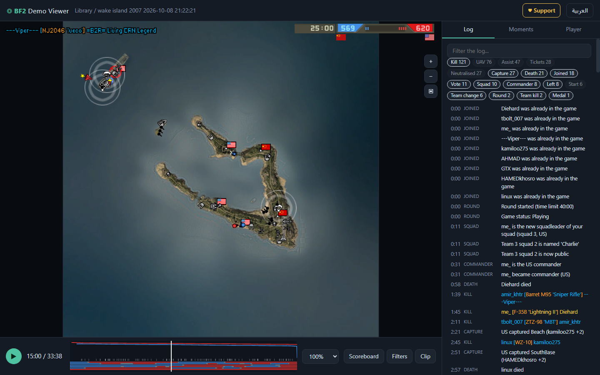
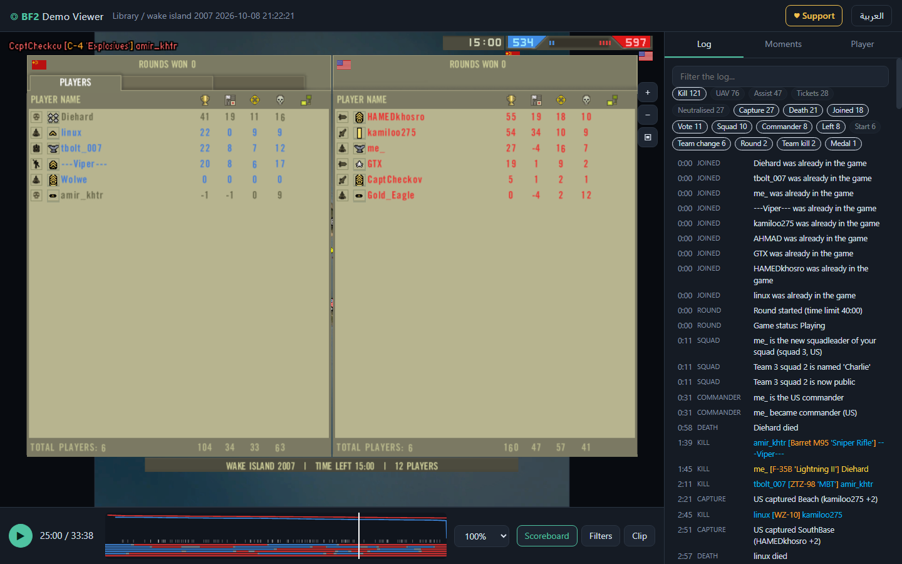
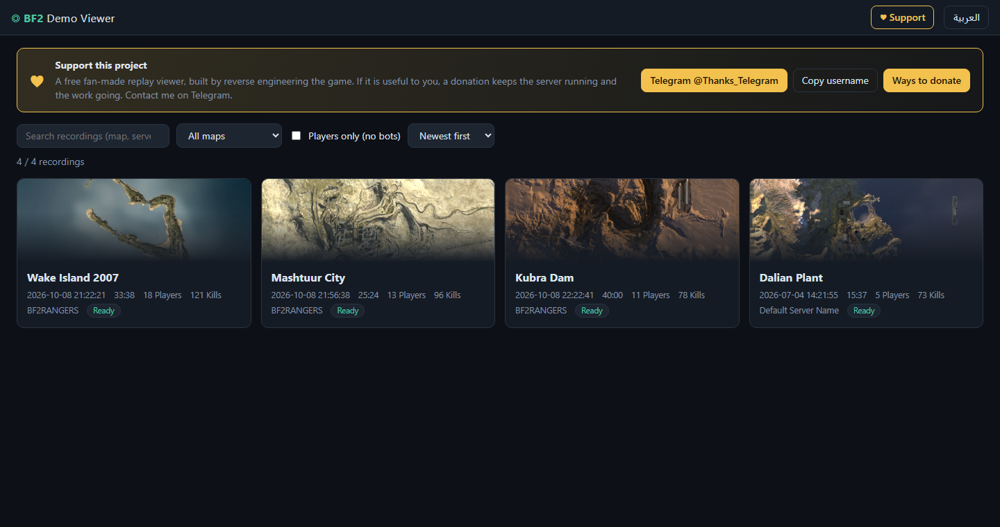
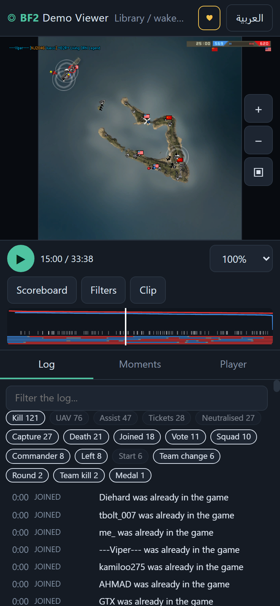
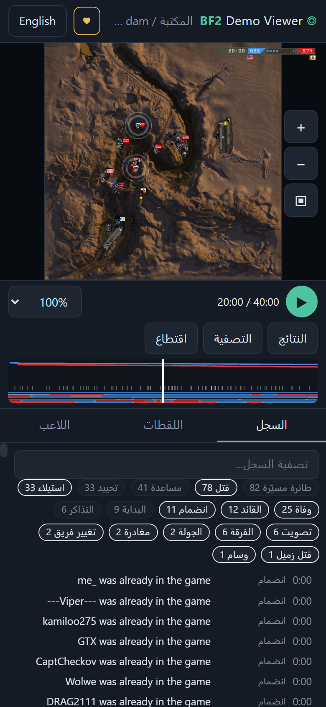
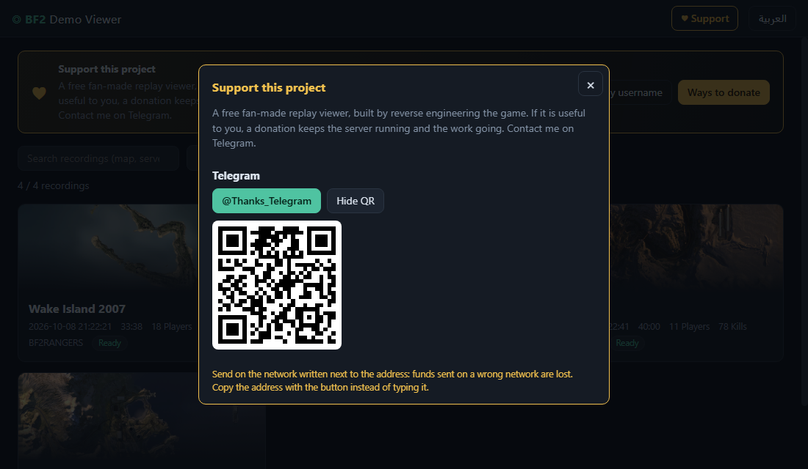
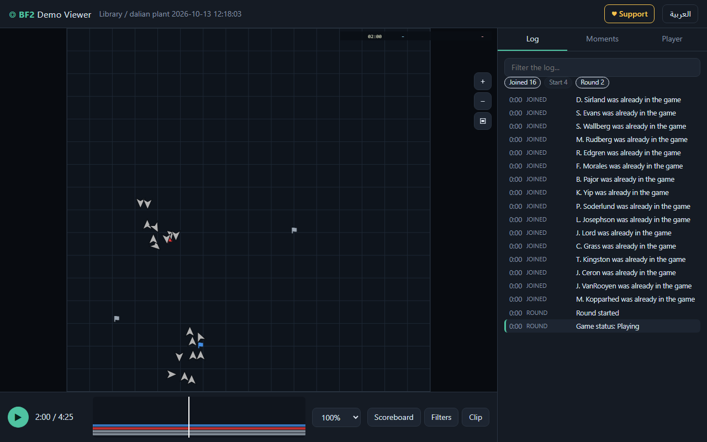

# BF2 Replay Viewer

**Read, analyse and replay Battlefield 2 recordings (`.bf2demo`) - in a terminal or in your browser, on a PC or a phone.**

`python` parser built by reverse engineering the game's own programs (no value is guessed) + a web viewer that draws the match on the game's
own minimap, with the kill feed, scoreboard, tickets, flags, vehicles, squads, scene clips (experimental) for the game's own replay player, and an English / Arabic UI.

> **Unofficial fan project** - not affiliated with or endorsed by EA or DICE. **No game content is included**: the viewer reads the icons,
> fonts and maps from *your own copy* of Battlefield 2 (see [Getting started](docs/GETTING_STARTED.md)). MIT license. See
> [NOTICE.md](NOTICE.md), [CREDITS.md](CREDITS.md). Support the project: [Telegram @Thanks_Telegram](https://t.me/Thanks_Telegram).

Topics: `battlefield-2` `bf2` `bf2demo` `replay-viewer` `demo-parser` `refractor-2` `reverse-engineering` `game-replay` `python` `flask`

## Quick start

```bash
git clone https://github.com/Kakarotto22/bf2-replay-viewer.git
cd bf2-replay-viewer
pip install -e ".[web]"                            # the parser alone needs nothing (Python 3.10+)

bf2demo path/to/round.bf2demo                      # readable report in the terminal
bf2view --demos path/to/recordings --port 8080     # then open http://127.0.0.1:8080/
```

* **Icons, fonts and the real minimap** come from your own Battlefield 2 install (found automatically in `Program Files (x86)\EA Games\Battlefield 2`,
  or set `BF2_GAME_ROOT`). Without one the viewer still works: a grid and plain shapes instead of artwork. How: [Getting started](docs/GETTING_STARTED.md#2-fetch-the-game-artwork-assets).
* **Phone friendly**: the side panels move under the map, pinch to zoom, tap a unit for details.
* **Put it on a server** (Linux, Caddy / nginx, systemd): [deploy/README.md](deploy/README.md).
* Guides: [Getting started](docs/GETTING_STARTED.md) | [البدء السريع](docs/GETTING_STARTED.ar.md) | [Screenshots how-to](docs/SCREENSHOTS.md) | [Parser user guide](docs/USAGE.en.md) | [دليل المحلل](docs/USAGE.ar.md).

<p align="center"></p>

<p align="center">
  
  
</p>

<p align="center">
  
  
  
  
</p>

*The pictures were taken with the author's own copy of the game installed (the map, icons and HUD are the game's, shown to illustrate the tool);
the last one shows the artwork-free mode. How they are made, and how to get the same look on your machine: [docs/SCREENSHOTS.md](docs/SCREENSHOTS.md).*

---

## Technical reference: the `bf2demo` parser

Python parser for Battlefield 2 (`.bf2demo`, Refractor 2 engine 1.5.3153) replays. Everything is decoded from the shipped game
binaries (the dedicated server `bf2_ia32` and `BF2.exe`); no value is guessed. Python 3.10+, standard library only.

```
python -m bf2demo DEMO.bf2demo                    # readable report (default)
python -m bf2demo DEMO --report players,flags     # chosen sections        (--list-sections shows them all)
python -m bf2demo DEMO --inventory                # every kind of data a demo can hold, and how much this demo has
python -m bf2demo DEMO --feed | --scoreboard | --tracks | --map-info | --events
python -m bf2demo DEMO --export-json out.json     # all of it as JSON (--json-tracks, --json-parts for poses and vehicle parts)
python -m bf2demo DEMO --export-con GamePlayObjects.con     # rebuild the server's flags / vehicle spawners / spawn points
python -m bf2demo DEMO --export-con OUT.con --merge OTHER1.bf2demo --merge OTHER2.bf2demo   # more recordings of the same map = more spawn points / exact spawners
python -m bf2demo DEMO --export-static StaticObjects.con    # networked static objects (bridges, crates, ...)
```

User guide: [English](docs/USAGE.en.md) | [العربية](docs/USAGE.ar.md).

`DATA.md` lists **everything a demo contains, and what it never can** (rebuild it with `python scripts/build_data_doc.py > DATA.md`).
Time is shown as `mm:ss` since the first simulation tick; the simulation runs at 30 ticks per second (`bf2demo/timeline.py`).

## Web viewer

Putting it on a server (Linux, Caddy / nginx, systemd, private beta behind a password): [deploy/README.md](deploy/README.md).

```
pip install flask pillow                          # the parser itself needs neither; the viewer needs Flask, Pillow is for map images
python -m bf2demo.web --demos samples --port 8080 # then open http://127.0.0.1:8080/
```

A library of the recordings in the given folders (`--demos` is repeatable, searched recursively; `.bf2demo` files can also be
uploaded in the page) and a replay viewer: map with play / seek / speed, soldiers and vehicles by team, squad or kit, filters
(team, kit, squad, player), kill feed and kill lines, death heatmap, trails, tickets and flag-ownership timeline, sortable
scoreboard, per-player page, log search, English / Arabic (RTL). Scenes can be exported as `.bf2demo` (Clip button, or `python -m bf2demo DEMO --clip OUT.bf2demo --clip-start 120 --clip-end 180`): an end-only cut is a plain shortened recording (safe); a start cut squashes the earlier packets into one tick so the game applies them at once (experimental, derived from the client's playback loop `FUN_0054bd20`, not yet tried in the game). A recording is parsed once in the background (seconds; a 2 hour 79 player
round takes about 3 minutes) and cached under `~/.bf2demo-viewer-cache` (`--cache DIR`). The server binds to 127.0.0.1 and clients only ever
name a recording by an opaque id, never a path.

Map backgrounds come from your own game install (`Levels/<map>/client.zip` minimap, world size from `server.zip` `Heightdata.con`): set
`BF2_GAME_ROOT` if it is not in the default `Program Files (x86)\EA Games\Battlefield 2`. No game artwork or level file is stored in this repository (only the small identifier tables listed in NOTICE.md);
without an install (or for a custom map) the viewer shows a grid fitted to the recorded positions. Deep links: `#/demo/<id>?t=<seconds>&p=<player id>&z=<zoom>`.
For the sharpest backgrounds download the *High Definition Minimap* pack (ModDB, 8192 px renders of every BF2 / Special Forces level), keep it under
`external_assets/hd_minimap/` (ignored by git) and run `python scripts/import_hd_maps.py external_assets/hd_minimap/HighDefinitionMinimap.zip`: each level is
converted to a 4096 px JPEG in `<cache>/hd_maps/` and checked against the installed minimap; the viewer uses it before anything else (`--maps DIR` adds
more folders, `<level>.jpg`). The pack is a game mod and is **not** installed into the game by this project.

The viewer builds its own small source from your game install, only what it draws (about 0.3 MB in `<cache>/game/`: `tables.json` with the vehicle / kit
icons and names and the few strings it shows, the HUD textures and the 8 bitmap fonts it uses, the minimap and facts of each level you open). It does this
on first use (`python -m bf2demo.web --build-assets` does it up front); afterwards the game install is not needed again. The HUD is the game's own: the
kill feed in the game's bitmap font and colours (own side blue, enemy red, commander yellow, the weapon orange, its quoted class in the line colour;
a vehicle's machine gun is named after the vehicle, a soldier's weapon after itself, no weapon prints `[Killed]`), the top bar (time left, both ticket
counters, flag bars; the counter of a team that bleeds tickets to the flags blinks and shows the loss per minute) and the live scoreboard (**Tab** or the
Scoreboard button: the game's `HudElementsScoreboard.con` layout with score, teamwork, kills and deaths at the chosen moment). Tickets are the values the server replicated, so the flag bleed is in the recording; the viewer only marks it, with the server's own rule
(`updateTicketLoss` of `gpm_cq.py`, parameters read from the installed level: `setTicketLossPerMin` of `Init.con`, `areaValueTeamN` of each control point in
`GameModes/<mode>/<size>/GamePlayObjects.con`): a team loses `lossPerMin * (area of the other side - own area) / 100` tickets a minute while the other
side holds an area of at least 100 and more than it does, so it stops when the areas are level. Checked on recordings: dragon_valley 9 flags of 12 area
each against 1 = 10 * (108 - 12) / 100 = 9.6 a minute = one ticket per 187.5 ticks; zatar_wetlands loses exactly 25 tickets per 5 minutes. Custom maps
without these files fall back to an estimate from the decrements no death explains. The map uses the game's own minimap icons (flat control point flags, soldier arrow turning with the `yaw` field, vehicles tinted by the
crew's team); a destroyed vehicle leaves the map at the tick it explodes (health field at or below `armor.wreckHitPoints`, the tick its crew dies), not
10 seconds later when the burning wreck is removed. The viewer document (`bf2demo/web/viewer_format.py`) keeps one pose sample per 6 ticks (5 Hz,
interpolated in the browser), without projectiles and without the log lines a replay does not need (spotting, radio calls, spawns, enter / exit).

Selecting a player shows the weapon in his hand (`weapon_item_index` of the soldier ghost = the weapon's `itemIndex` in his kit, `assets/weapon_slots.json` from `scripts/build_weapon_slots.py`; it names the killing weapon of 20 of 24 hand-weapon kills of `zxc`, the rest are thrown grenades, mines and weapon changes). Health and ammo are not in the recorded data: the soldier ghost has no health field and no weapon is a ghost.

Clips (`--clip`, or the Clip drawer) put a welcome message into the server settings block (`bf2demo/signature.py`: `sv.welcomeMessage` lines; every
other bit of every packet is unchanged; `--no-signature` or the drawer's checkbox leaves it out). Whether the game shows it while replaying a recording is
not verified.

## Layout

| module | what it does |
|---|---|
| `reader.py`, `bitstream.py`, `packet.py` | file framing (zlib), LSB-first bit reader, packet = events + ghost records |
| `events.py` | the 63 game event layouts; `EVENT_NAMES`, `register_event` |
| `postremote.py` | server-to-client HUD/game events carried by `PostRemote` |
| `networkables.py`, `objectnet.py`, `ghostbits.py` | ghost (replicated object) decoders: Player, ControlPoint, SpawnGroup, soldier, vehicle parts |
| `templatedb.py`, `templates.py` | object template ids and names of the game and of each level |
| `serverinfo.py` | server settings and current map blocks (`DataBlock` kinds 0 and 2) |
| `replay.py` | `build_replay(demo)`: the match model (players, objects, control points, spawn sites, tickets) |
| `feed.py`, `report.py`, `inventory.py`, `timeline.py` | game log, readable report, data catalogue, tick clock |
| `tracks.py`, `jsonexport.py` | movement tracks, JSON document |
| `merge.py` | several recordings of one map as one replay (`--merge`) |
| `export_con.py`, `export_static.py`, ... | `GamePlayObjects.con` / `StaticObjects.con` reconstruction |
| `scripts/` | reverse-engineering helpers (`decomp.py` Ghidra, `asm_fn.py`, `event_asm.py`, `field_owners.py`, `bit_coverage.py`) |

## Extending

* **A new event layout:** write `def _reader(bs): return {...}` and call `events.register_event(eid, "Name", _reader)`
  (existing ones live in the `_READERS` table of `events.py`). Check it with `scripts/bit_coverage.py DEMO` (must stay 100 %).
* **A new part of the report:** a function decorated with `@report.section("key", "Title", "help")` returning lines.
* **A new kind of data in the catalogue:** one `Category(...)` entry in `inventory.CATALOG`, then regenerate `DATA.md`.
* **Naming an unknown field:** `scripts/field_owners.py CLASS 0xOFFSET` lists the accessors of a class that touch an object offset;
  `scripts/asm_fn.py` / `scripts/decomp.py` show the code. Name it from the binary or leave it visibly unknown (`unk_*`, `flag_*`).

Tests: `python -m unittest discover -s tests -t .` (about 4 minutes; each module is also runnable alone).

## JSON format 2

`--export-json` documents are `bf2demo-json/2`. Compared with `/1`: new keys `server_settings` and `map_info`; renamed event fields
`CreatePlayer.field_d`/`unk_34` -> `spawn_group`/`reserved`, `MissileInit.unk_f`/`flag` -> `weapon_slot`/`from_soldier`,
`EnterVehicle.flag` -> `is_spawn`, `PostRemote.value_4c` -> `delay` (float), `Artillery.flag`/`value_18` -> `team`/`tick`,
`BeginRound.state`/`value_10` -> `begin_round_state`/`next_state_change_tick`; Player ghost `byte_ac`/`byte_b1`/`flag_17c`/`flag_3c`/
`sprint_b` -> `time_outside_world`/`squad_invite_mask`/`is_connected`/`is_squad_leader`/`sprinting_last_tick`; ControlPoint `flag_158` ->
`area_value_active`; soldier `lean_a`/`lean_b`/`flag_7d`/`flag_7e` -> `pose`/`requested_pose`/`is_sky_diving`/`is_swimming`.

## Support

This is a free, spare-time project: reverse engineering a game format and a replay viewer. If it is useful to you, a donation helps to keep the
demo server running and the work going. Donations are for the project's development and hosting costs; they buy no rights to the game or its content.

* Telegram: [@Thanks_Telegram](https://t.me/Thanks_Telegram) - write to me for the donation details, bug reports or recordings you want to see supported.
* The hosted viewer shows the same button with a copy button for each wallet (`BF2VIEW_DONATE_TELEGRAM` and `BF2VIEW_DONATE_FILE`, see `deploy/donate.example.json`).
* Free ways to help: star the repository, report a recording that does not decode, add a verified field name.

## Thanks

**[BF2Rangers](https://bf2rangers.wixsite.com/site)** (community and server, whose long rounds tested the decoder),
**[kr4uzi/gamespy-emulator](https://github.com/kr4uzi/gamespy-emulator)**, **[Moxnatiy/OpenBattlefield2](https://github.com/Moxnatiy/OpenBattlefield2)**,
**[matthias-hoste/Refractor-2-BitStream-Emulator](https://github.com/matthias-hoste/Refractor-2-BitStream-Emulator)** and **aluigi** (BF2Loop),
the **BF2 technical reference** (darkstormstudios), the author of the **High Definition Minimap** pack, **2F4Y.com**, and the teams behind Ghidra, Flask and
Pillow. Full list and licenses: [CREDITS.md](CREDITS.md).

## Legal

Unofficial fan project, MIT license (code and documentation only). No game files are included or redistributed. Read [NOTICE.md](NOTICE.md)
(what the repository contains, privacy of recordings, takedown contact), [CREDITS.md](CREDITS.md) and [CONTRIBUTING.md](CONTRIBUTING.md).
